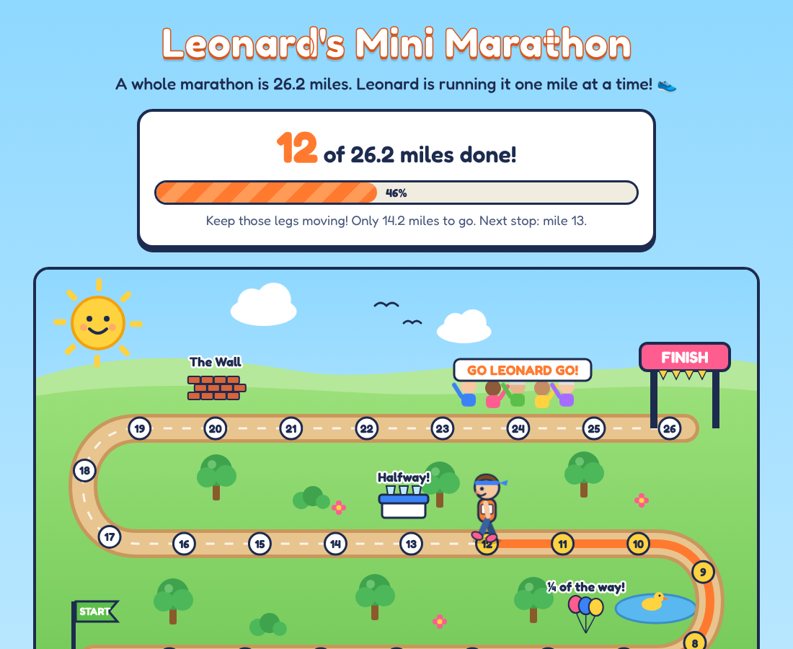

# Leonard's Mini Marathon 🏃

A one-page website where family can follow Leonard as he runs a whole marathon (26.2 miles), one mile at a time. Leonard logs each mile himself with a secret passcode.



## What's on the page

- A big "X of 26.2 miles" scoreboard and progress bar (easy to read for grandparents).
- A cartoon map: a winding trail from START to FINISH with 26 mile markers, a little runner who moves along it, a cheering crowd, a water station at halfway and "The Wall" at mile 20.
- Stickers Leonard unlocks at 1, 5, 10, 13.1, 20 and 26.2 miles.
- "How far is that?" facts (steps, blue whales, buses, snails).
- Leonard's running diary: every mile with its date and an optional note.
- Confetti whenever a new mile appears, and a big celebration at the finish.
- **Leonard's corner** at the bottom: he types his passcode, then taps **I ran a mile!** He can pick the date, add a note, and undo a mistake.

Each run counts as one mile, except the very last one, which is the final 0.2 miles.

## How it's hosted (free)

The site runs as a **Cloudflare Worker** (free plan):

- `public/index.html` is the whole page, served as static assets.
- `src/worker.js` sends `/api/progress` to `functions/api/progress.js`. Anyone can **read** progress; **adding or undoing** a mile needs the passcode.
- Miles are saved in **Cloudflare KV** (the `leonard-miles` namespace, bound as `MILES` in `wrangler.toml`).

### Why it's safe

- The passcode is stored as an **encrypted secret in Cloudflare**, never in this repo or in the page.
- The server checks it on every change, using a timing-safe comparison.
- 5 wrong guesses lock that device out for 15 minutes, so nobody can guess it by trying lots of codes.
- Changes are only accepted from the site itself; notes are length-limited and shown as plain text.
- "Remember me on this device" keeps the passcode on Leonard's own phone/tablet only. Tap **Lock** to forget it.

Pick a passcode that's easy for Leonard but hard to guess, like three words (`purple-rocket-socks`).

## Setting it up (one time)

1. In the Cloudflare dashboard, open **Workers & Pages → leonard-mini-marathon**.
2. **Connect GitHub:** *Settings → Build → Connect* and pick `adonald/leonard-mini-marathon`, branch `main`.
   Leave the build command empty; the deploy command is `npx wrangler deploy`. Every merge to `main` then redeploys the site.
3. **Set the passcode:** *Settings → Variables and Secrets → Add*, type **Secret**,
   name `LOG_PASSCODE`, value: Leonard's passcode.
4. Open the site at `https://leonard-mini-marathon.<your-subdomain>.workers.dev` (shown on the Worker's overview page) and share the link with the family.

To change the passcode later, edit the `LOG_PASSCODE` secret; it takes effect straight away.

## Trying it on your own computer

```sh
npm install
npm run dev     # opens http://localhost:8787, passcode is "letmein"
npm test        # checks the passcode, lockout and mile rules
```
